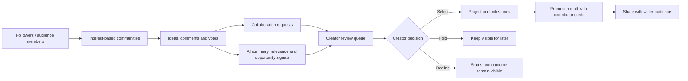
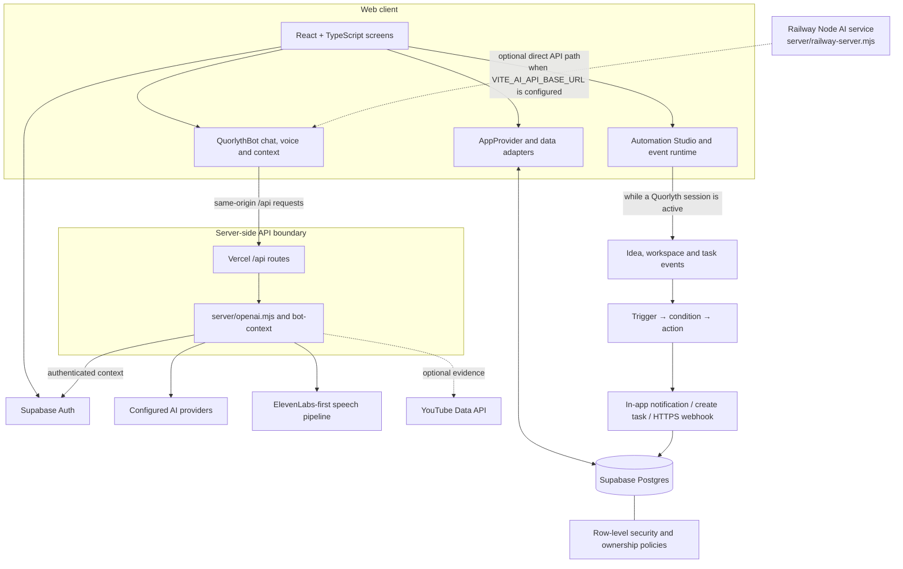
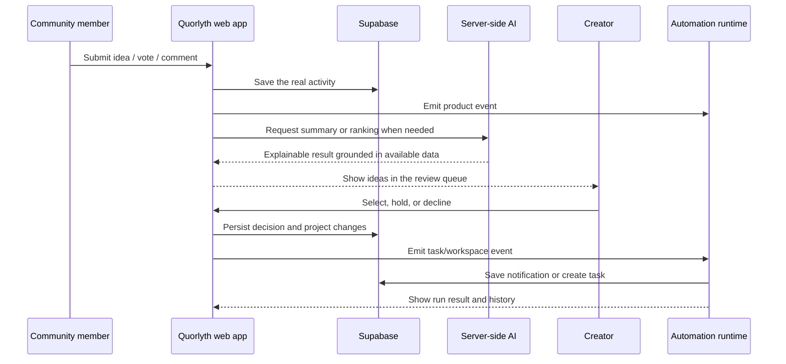

# Quorlyth architecture

Quorlyth is an operating system for fanbases: it turns scattered audience activity into an organized, explainable path from ideas to real work.

## 1. Product workflow

This is the main challenge journey: **Followers → Organized Communities → Ideas → Collaboration → Action**. AI helps prioritize real activity, but the creator makes the decision. A promotion is a draft until an external publishing integration confirms publication.

## 2. Technical architecture

### Responsibilities by layer

- **React + TypeScript:** the dashboard, communities, idea pages, review queue, projects, milestones, promotion drafts, profiles, QuorlythBot, and automation UI.
- **AppProvider/data adapters:** loads the current user's data, exposes product actions, and coordinates production data versus demo behavior.
- **Supabase:** authentication and shared app records. Database row-level security and server-side ownership checks are the security boundary for private records.
- **Vercel API routes:** same-origin server-side endpoints for chat, structured AI tasks, realtime-session setup, speech and provider fallback. Provider keys stay on the server. With the current production configuration, `VITE_AI_API_BASE_URL` is blank, so the browser uses the same-origin `/api` routes.
- **AI and voice:** the server ranks/summarizes actual idea and collaboration context; ElevenLabs is preferred for generated speech, with configured provider/browser fallback where available. Optional YouTube signals enrich idea review only when the API is configured and returns usable evidence.
- **Railway AI service:** the Node service is deployed and can serve the same handler family. It is an optional direct path, not the default browser path while `VITE_AI_API_BASE_URL` remains blank.
- **Workflow automations:** user-owned workflow definitions connect triggers to conditions and actions. The current runtime handles product events while a Quorlyth session is active; it is not yet an always-on server worker when every browser is closed.

## 3. Event and automation flow

Automations currently support manual, idea-created, task-completed and workspace-created triggers; notification, task-creation and HTTPS-webhook actions; and a per-step run history. A live browser/session is currently required for event-driven runs. An always-on queue/worker, scheduled triggers, retries and delivery monitoring are a next architecture step—not a current capability.

## 4. Security and reliability rules

1. API/provider credentials stay in Vercel/Railway server environment variables; no secret belongs in a `VITE_*` setting.
2. Supabase policies and authenticated ownership checks protect private creator/member records. CORS is not a substitute for authorization.
3. AI results must be based on available activity and explain their rationale; missing provider quota/credentials should produce an honest failure state, not fabricated metrics.
4. A promotion draft must not be described as externally published without confirmation from an actual publishing integration.
5. Voice preview and chat replies use the same ElevenLabs-first pipeline, while voice playback remains subject to browser media permissions and autoplay rules.

## 5. Next production hardening steps

- Move automation execution to an authenticated server-side queue/worker so workflows continue when the creator closes the browser.
- Add schedules, retries, idempotency keys, webhook signing, delivery logs and per-action secret management.
- Validate the full creator/member journey in production with two separate accounts and confirm refresh persistence and denial behavior against production policies.
- Add explicit provider health checks and end-to-end voice tests against the deployed environment without recording or exposing credentials.
